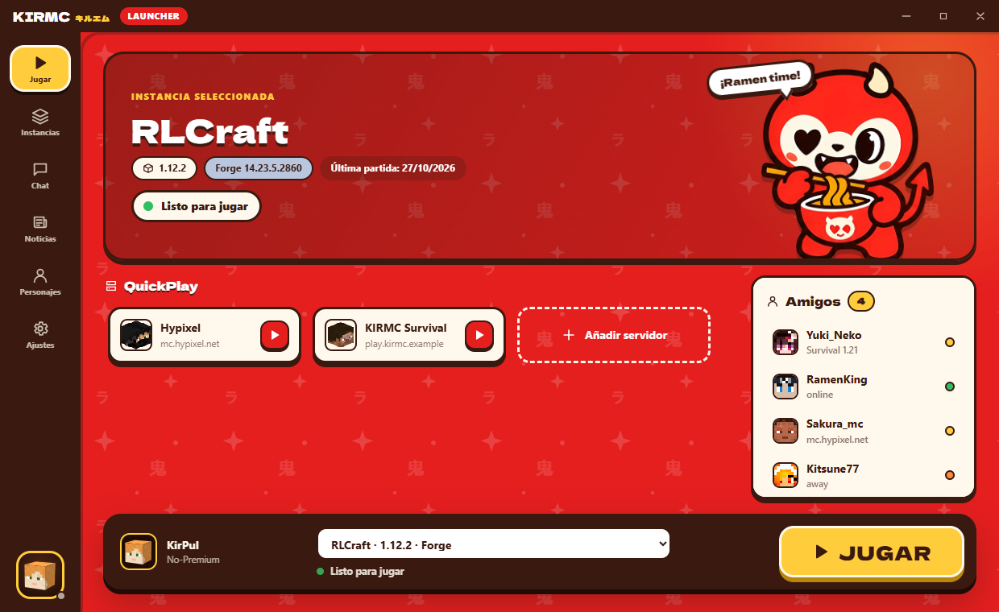
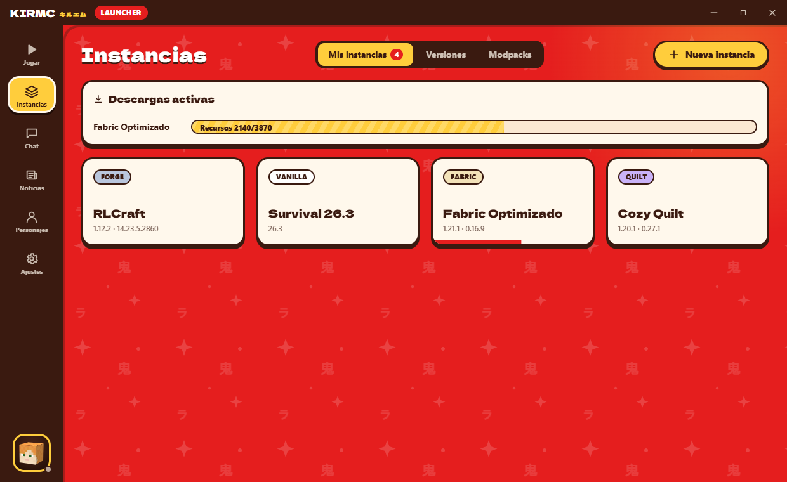
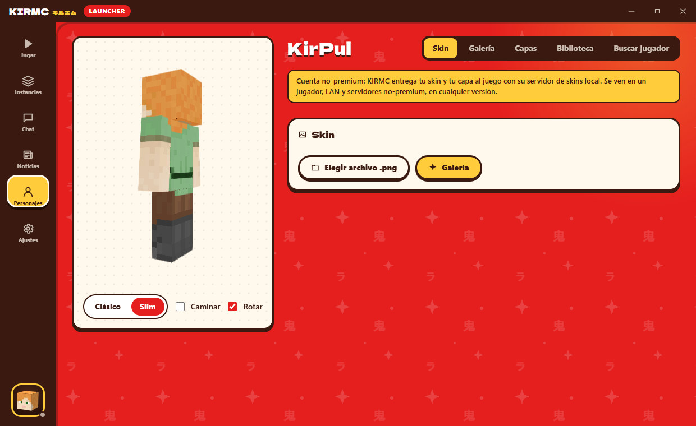
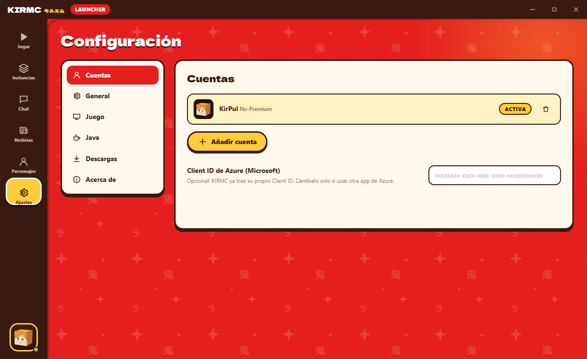
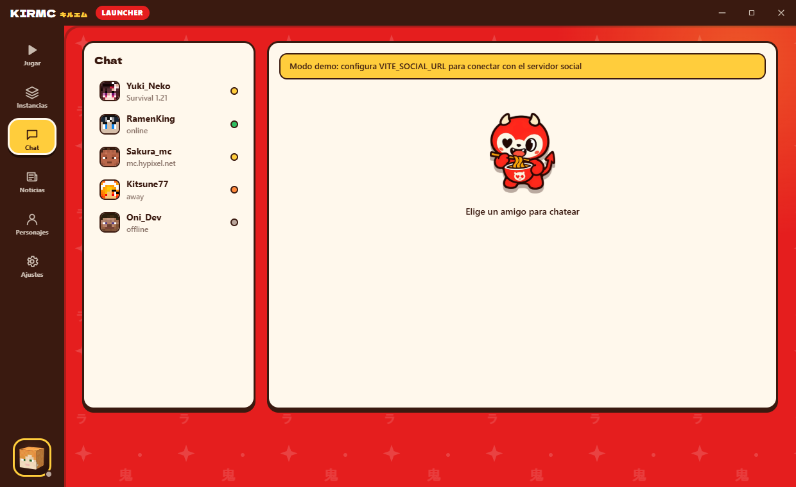

<div align="center">


# KIRMC LAUNCHER

**Un launcher de Minecraft ultraligero, rápido y con estilo japonés.**
小さな悪魔、大きな冒険。


[**⬇ Descargar para Windows**](../../releases/latest) · [Capturas](#-capturas) · [Funciones](#-funciones) · [Compilar](#-compilar-desde-el-código)

</div>

---

<p align="center">
  
</p>

## 📸 Capturas

| Instancias | Personajes (visor 3D) |
|---|---|
|  |  |
| **Ajustes** | **Chat** |
|  |  |

## ✨ Funciones

**🎮 Jugar**
- Barra de juego estilo launcher: cuenta, instancia y un gran botón **JUGAR**.
- **QuickPlay**: entra directo a tus servidores favoritos.
- Mascota animada que reacciona al estado del launcher (preparando, jugando, error).

**📦 Instancias**
- Todas las versiones oficiales: release, snapshot, beta y alpha.
- **Forge, Fabric y Quilt** con un clic.
- **Modrinth integrado**: mods, resource packs y shaders, filtrados por versión y cargador, con sus dependencias, y modpacks `.mrpack`.
- **Java automático**: cada versión usa el Java que necesita (8, 17, 21, 25…) y, si falta, se descarga solo (Eclipse Temurin).
- RAM, argumentos JVM y logs en vivo por instancia.

**👤 Cuentas y skins**
- **Premium**: inicio de sesión con la ventana oficial de Microsoft; el launcher nunca ve tu contraseña.
- **No-Premium**: con **skinfix local**. KIRMC incluye un pequeño servidor de skins (Yggdrasil + authlib-injector), así que tu skin y tu capa se ven en el juego, en cualquier versión.
- **Galería de skins** (MineSkin), **explorador de capas** (Minecraft, OptiFine, LabyMod, MinecraftCapes y más vía capes.dev) y skins de **Ely.by**.
- Visor 3D, biblioteca local de skins y capas, y cabeza 3D de tu jugador en la barra lateral.

**⚙️ Ajustes**
- Español · 日本語 · English.
- Notificaciones, varias instancias a la vez, qué hacer al lanzar (mantener, ocultar o cerrar).
- Resolución, pantalla completa, descargas en paralelo, verificación SHA-1 y animaciones activables.

## 🪶 Ligero de verdad

| | KIRMC (Tauri 2 + Rust) | Launcher típico (Electron) |
|---|---|---|
| Instalador | **~6 MB** | 80–150 MB |
| RAM en reposo, proceso principal | **~30 MB** | 150–300 MB |
| Lógica pesada | Rust nativo, sin recolector de basura | JavaScript |

Además, solo se monta la sección abierta, el visor 3D se carga bajo demanda, las animaciones usan solo la GPU (`transform`/`opacity`) y, si lo activas, el launcher se oculta mientras juegas.

## 🧩 Arquitectura

```
┌──────────────────────── WebView2 (React 18 + Vite) ────────────────────────┐
│  Jugar · Instancias · Chat · Noticias · Personajes · Ajustes   (lazy)      │
│        │ invoke() tipado (src/lib/api.ts)          ▲ eventos por lotes     │
└────────┼───────────────────────────────────────────┼───────────────────────┘
         ▼                                           │
┌──────────────────────────── Núcleo Rust (Tauri 2) ─────────────────────────┐
│ auth/       Microsoft (auth code) → Xbox Live → XSTS → Minecraft · offline │
│ minecraft/  manifiesto · herencia de versiones · reglas · Forge/Fabric/    │
│             Quilt · descargas paralelas + SHA-1 · lanzamiento              │
│ java        detección + descarga automática (Adoptium)                     │
│ modrinth    búsqueda, dependencias, .mrpack                                │
│ skins       MineSkin · capes.dev · Ely.by · Mojang · biblioteca local      │
│ yggdrasil   servidor de skins local para no-premium (authlib-injector)     │
└───────┬──────────────────────────────┬─────────────────────────────────────┘
        ▼                              ▼
  %APPDATA%/KIRMC (compartido)   Almacén seguro de Windows
  versions · libraries · assets  (refresh token de Microsoft)
  instances/<id>/.minecraft
```

<details>
<summary><b>Estructura de carpetas</b></summary>

```
kirmc-launcher/
├── public/mascot.png              # mascota (PNG transparente)
├── docs/screenshots/              # capturas del README
├── scripts/prepare-mascot.mjs     # quita el fondo de la mascota y genera el icono
├── src/                           # interfaz (React + TypeScript)
│   ├── lib/        api.ts · social.ts · demo.ts
│   ├── store/      app.ts (zustand)
│   ├── i18n/       es · en · ja
│   ├── components/ Sidebar · PlayerHead (cabeza 3D CSS) · Mascot · skins/ · instances/
│   ├── pages/      Play · Instances · Chat · News · Characters · Settings
│   └── styles/     theme.css · global.css · pages.css
└── src-tauri/src/                 # backend (Rust)
    ├── auth/       mod.rs · microsoft.rs · offline.rs
    ├── minecraft/  manifest · version · rules · loaders · download · launch
    ├── java.rs · modrinth.rs · skins.rs · yggdrasil.rs
    └── instances.rs · config.rs · news.rs · notify.rs
```
</details>

<details>
<summary><b>Flujos clave</b></summary>

- **Lanzamiento**: JSON de la versión → Java correcto (descarga si falta) → instala el cargador (Fabric/Quilt: perfil JSON; Forge: instalador oficial) → fusiona la herencia `inheritsFrom` → descargas en paralelo → natives → argumentos (`${…}`, reglas, G1GC) → proceso sin ventana de consola.
- **Login Microsoft**: ventana con `login.live.com` → captura la redirección a `oauth20_desktop.srf?code=…` → canje del código → Xbox Live → XSTS → `login_with_xbox`. El refresh token va al almacén seguro de Windows; el token de Minecraft solo vive en memoria.
- **Skinfix no-premium**: al abrir el launcher arranca un servidor Yggdrasil en `127.0.0.1` con su propia clave RSA. Al jugar se añade `-javaagent:authlib-injector.jar=http://127.0.0.1:<puerto>`, y las texturas se firman con SHA1withRSA.
- **QuickPlay**: `--quickPlayMultiplayer` en 1.20+, `--server/--port` en versiones anteriores.
</details>

## 🛠 Compilar desde el código

Requisitos: **Node 20+**, **Rust stable** (`rustup`), **Visual Studio Build Tools** (C++) y WebView2 (ya viene en Windows 11).

```bash
npm install
npm run tauri dev                      # desarrollo
npm run tauri build -- --bundles nsis  # instalador .exe
```

> Si la carpeta del proyecto tiene una ruta muy larga, define `CARGO_TARGET_DIR` con una ruta corta (por ejemplo `%LOCALAPPDATA%\kt`) para evitar el error `LNK1104` de Windows.

**Vista previa sin backend:** `npm run dev` y abre `http://localhost:1420/?demo` (opcional `&page=instances|characters|settings|chat`). Así se hicieron las capturas.

**Cuentas Premium:** KIRMC trae su propio Client ID de Azure; puedes usar otro desde *Ajustes → Cuentas*. Para que Minecraft acepte el login, la app debe estar aprobada por Mojang ([formulario](https://aka.ms/mce-reviewappid)).

## 🗺 Hoja de ruta

- [x] Vanilla, Forge, Fabric y Quilt
- [x] Modrinth (mods, shaders, resource packs, modpacks)
- [x] Java automático
- [x] Skinfix local para no-premium
- [ ] NeoForge y CurseForge
- [ ] Servidor social propio (chat y amigos en tiempo real; la interfaz ya está lista)
- [ ] Builds para macOS y Linux

---

<div align="center">
<sub>Hecho con 🍜 y Rust. Minecraft es una marca de Mojang Studios; KIRMC no está afiliado a Mojang ni a Microsoft.</sub>
</div>
